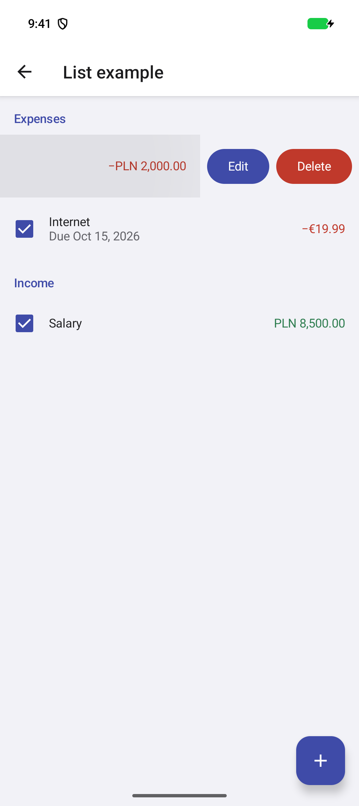

# ✗ keeps the open Android row background unchanged

`e2e/design-system-list.e2e.ts` · target `android` · failed · 41.7s

Ran on: platform `android` · device `BudgetLens-Android`

**ASSERTION_FAILED**

```text
expect.toHaveScreenshot failed
112248 pixels (99% of the image) differ from e2e/design-system-list.e2e.ts-snapshots/android-rent-open-android-darwin.png; run with --update-snapshots to keep this run's
diff: .e2e/red/results/design-system-list-keeps-the-open-android-row-89c4dfad357791d5/attempt-1/screenshots/android-rent-open-diff.png
actual: .e2e/red/results/design-system-list-keeps-the-open-android-row-89c4dfad357791d5/attempt-1/screenshots/android-rent-open-actual.png
expected: .e2e/red/results/design-system-list-keeps-the-open-android-row-89c4dfad357791d5/attempt-1/screenshots/android-rent-open-expected.png
```

Look at: `e2e/design-system-list.e2e.ts:110`  

## Steps

1. ✓ `app.open` (1.6s) — `e2e/support/showcase.ts:52`
2. ✓ `expect.toBeVisible` `getByTestId("screen-home")` (5.1s) — `e2e/support/showcase.ts:53`
   - expect passed after 27 reads in 5.1s: no node (0 matches) x26 -&gt; at 5075ms default states (1 match)
   - screen: 54 nodes at `com.budgetlens.offline`
3. ✓ `device.openLink` `budget-lens:///dev/design-system-list` (270ms) — `e2e/support/showcase.ts:54`
4. ✓ `expect.toBeVisible` `getByTestId("screen-design-system-list")` (511ms) — `e2e/support/showcase.ts:57`
   - screen: 103 changes since step 2 at `com.budgetlens.offline`, 113 nodes
     - `added button "Navigate up"`
     - `added text "List example"`
     - `added group testid="screen-design-system-list"`
     - `added group testid="ds-list"`
     - `added text "Expenses" testid="ds-list-expenses"`
     - `added group testid="ds-row-rent"`
     - `added group "Paid: Rent"`
     - `added text "Rent"`
     - `added text "Due Oct 10, 2026"`
     - `added text "−PLN 2,000.00" text="−PLN 2,000.00"`
     - `added checkbox`
     - `added group testid="ds-row-rent-edit"`
     - 91 more
5. ✓ `expect.toBeVisible` `getByTestId("ds-row-rent")` (195ms) — `e2e/support/showcase.ts:78`
   - screen: unchanged since step 4 at `com.budgetlens.offline`
6. ✓ `screen.swipe` `(918, 499.5) → (270, 499.5)` (522ms) — `e2e/support/showcase.ts:83`
   - swipeTo at (918, 500) (522ms)
7. ✗ `expect.toHaveScreenshot` `getByTestId("ds-row-rent") vs android-rent-open.png` (31.3s) — **ASSERTION_FAILED** — `e2e/design-system-list.e2e.ts:110`
   - [screenshot](attempt-1/screenshots/android-rent-open-diff.png) `.e2e/red/results/design-system-list-keeps-the-open-android-row-89c4dfad357791d5/attempt-1/screenshots/android-rent-open-diff.png`
   - [screenshot](attempt-1/screenshots/android-rent-open-actual.png) `.e2e/red/results/design-system-list-keeps-the-open-android-row-89c4dfad357791d5/attempt-1/screenshots/android-rent-open-actual.png`
   - [screenshot](attempt-1/screenshots/android-rent-open-expected.png) `.e2e/red/results/design-system-list-keeps-the-open-android-row-89c4dfad357791d5/attempt-1/screenshots/android-rent-open-expected.png`
   - screen: 2 changes since step 5 at `com.budgetlens.offline`, 111 nodes
     - `removed text "Rent"`
     - `removed text "Due Oct 10, 2026"`

## Screen at failure

`com.budgetlens.offline` · viewport 1080x2424 · 111 nodes  



The screen as the agent reads it, one node per line: `#id role "name" text="…" [states]`.

```text
#root screen
 #n5143 group
  #n5144 group
   #n5145 group
    #n5146 group testid="com.budgetlens.offline:id/action_bar_root"
     #n5147 group testid="android:id/content"
      #n5148 group
       #n5149 group
       #n5150 group
        #n5151 group
         #n5152 group
          #n5153 group
          #n5154 group
          #n5155 group
          #n5156 group
          #n5157 button "Navigate up"
          #n5158 text "List example"
          #n5159 group
          #n5160 group
          #n5161 group testid="screen-design-system-list"
          #n5162 group testid="ds-list"
          #n5163 group
          #n5164 group
          #n5165 text "Expenses" testid="ds-list-expenses"
          #n5166 group
          #n5167 group
          #n5168 group
          #n5169 group
          #n5170 group
          #n5171 group
          #n5172 group
          #n5173 group testid="ds-row-rent"
          #n5174 group "Paid: Rent"
          #n5175 text "−PLN 2,000.00" text="−PLN 2,000.00"
          #n5176 checkbox
          #n5177 group
          #n5178 group
          #n5179 group
          #n5180 group
          #n5181 group testid="ds-row-rent-edit"
          #n5182 group "Edit: Rent"
          #n5183 text "Edit"
          #n5184 button
          #n5185 group
          #n5186 group
          #n5187 group
          #n5188 group testid="ds-row-rent-delete"
          #n5189 group "Delete: Rent"
          #n5190 text "Delete"
          #n5191 button
          #n5192 group
          #n5193 group
          #n5194 group
          #n5195 group
          #n5196 group
          #n5197 group
          #n5198 group
          #n5199 group testid="ds-row-internet" [checked]
          #n5200 group "Paid: Internet"
          #n5201 text "Internet"
          #n5202 text "Due Oct 15, 2026"
          #n5203 text "−€19.99"
          #n5204 checkbox
          #n5205 group
          #n5206 group
          #n5207 group
          #n5208 group
          #n5209 group testid="ds-row-internet-edit"
          #n5210 group "Edit: Internet"
          #n5211 text "Edit"
          #n5212 button
          #n5213 group
          #n5214 group
          #n5215 group
          #n5216 group testid="ds-row-internet-delete"
          #n5217 group "Delete: Internet"
          #n5218 text "Delete"
          #n5219 button
          #n5220 group
          #n5221 text "Income" testid="ds-list-income"
          #n5222 group
          #n5223 group
          #n5224 group
          #n5225 group
          #n5226 group
          #n5227 group
          #n5228 group
          #n5229 group testid="ds-row-salary" [checked]
          #n5230 group "Paid: Salary"
          #n5231 text "Salary"
          #n5232 text "PLN 8,500.00" text="PLN 8,500.00"
          #n5233 checkbox
          #n5234 group
          #n5235 group
          #n5236 group
          #n5237 group
          #n5238 group testid="ds-row-salary-edit"
          #n5239 group "Edit: Salary"
          #n5240 text "Edit"
          #n5241 button
          #n5242 group
          #n5243 group
          #n5244 group
          #n5245 group testid="ds-row-salary-delete"
          #n5246 group "Delete: Salary"
          #n5247 text "Delete"
          #n5248 button
          #n5249 group
          #n5250 group
          #n5251 group
          #n5252 button "Add item" testid="ds-add-button"
```

## Evidence

- [screenshot](attempt-1/screenshots/001-failure.png) `.e2e/red/results/design-system-list-keeps-the-open-android-row-89c4dfad357791d5/attempt-1/screenshots/001-failure.png`
- [screen](attempt-1/screen-at-failure.txt) `.e2e/red/results/design-system-list-keeps-the-open-android-row-89c4dfad357791d5/attempt-1/screen-at-failure.txt`
- [screenshot](attempt-1/screenshots/android-rent-open-diff.png) `.e2e/red/results/design-system-list-keeps-the-open-android-row-89c4dfad357791d5/attempt-1/screenshots/android-rent-open-diff.png`

<sub>e2e 0.21.2 · run `01a15adb-1f57-77fd-8562-192c4af7f373` · the whole run is in `report.json`</sub>
