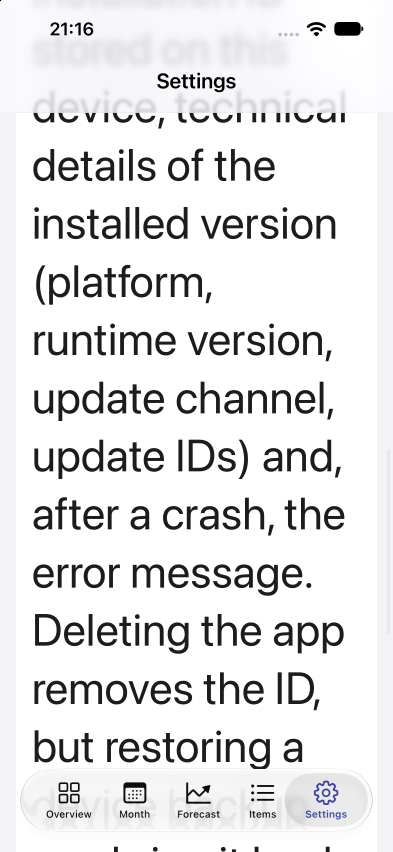

# ✗ keeps every showcase control reachable at 200% text size

`e2e/large-text.e2e.ts` · target `ios` · failed · 17.5s

Ran on: platform `ios` · device `BudgetLens-CI`

**ENGINE_FAILURE**

```text
swipe failed: scroll down moved nothing: the container still reports hidden content below and its contents never shifted Hint: The scroll is not reaching this container. If a field is focused, dismiss the keyboard first; if it is nested inside another scroller, target it directly with scroll down --until <selector>. Some lists ignore synthesized scrolls — a raw drag moves them: swipe x1 y1 x2 y2 started inside the list.
```

Look at: `e2e/support/showcase.ts:15`  

## Steps

1. ✓ `app.open` (1.9s, video 0:00) — `e2e/support/showcase.ts:9`
2. ✓ `expect.toBeVisible` `getByTestId("screen-home")` (2.1s, video 0:01) — `e2e/support/showcase.ts:10`
   - expect passed after 3 reads in 2.1s: no node (0 matches) x2 -&gt; at 2069ms default states (1 match)
   - screen: 29 nodes at `com.budgetlens.offline / Overview`
3. ✓ `locator.tap` `getByTestId("tab-settings")` (784ms, video 0:03) — `e2e/support/showcase.ts:38`
   - tap tab "Settings" (783ms)
   - screen: unchanged since step 2 at `com.budgetlens.offline / Overview`
4. ✗ `screen.scrollUntilVisible` `getByTestId("settings-open-design-system")` (8.2s, video 0:05) — **ENGINE_FAILURE** — `e2e/support/showcase.ts:15`
   - screen: 23 changes since step 3 at `com.budgetlens.offline / Settings`, 26 nodes
     - `added navigation testid="Settings"`
     - `added text "Settings"`
     - `added other testid="screen-settings"`
     - `added other testid="settings-privacy"`
     - `added text "Your budget data stays on this device and is never sent anywhere. Each time the app starts (store and TestFlight versions), it checks for app updates with Expo, the update service; this i…`
     - `added text "Your budget data stays on this device and is never sent anywhere. Each time the app starts (store and TestFlight versions), it checks for app updates with Expo, the update service; this i…`
     - `added other "Vertical scroll bar, 5 pages" value="54%"`
     - `added other "Vertical scroll bar, 5 pages" value="54%"`
     - `added tab "Overview" testid="tab-overview"`
     - `added tab "Settings" testid="tab-settings" [selected]`
     - `removed navigation testid="Overview"`
     - `removed text "Overview"`
     - 11 more

## Screen at failure

`com.budgetlens.offline / Settings` · viewport 393x852 · 26 nodes  



The screen as the agent reads it, one node per line: `#id role "name" text="…" [states]`.

```text
#root screen
 #n531 application "Budget Lens"
  #n532 navigation testid="Settings"
   #n533 text "Settings"
  #n534 other testid="screen-settings"
   #n535 scroll-view
    #n536 other testid="settings-privacy"
    #n537 text "Your budget data stays on this device and is never sent anywhere. Each time the app starts (store and TestFlight versions), it checks for app updates with Expo, the update service; this is the only connection the app makes. Each check sends a random installation ID stored on this device, technical details of the installed version (platform, runtime version, update channel, update IDs) and, after a crash, the error message. Deleting the app removes the ID, but restoring a device backup can bring it back. Expo also sees your IP address. The app does not track you and has no ads or analytics." testid="settings-privacy-updates"
     #n538 text "Your budget data stays on this device and is never sent anywhere. Each time the app starts (store and TestFlight versions), it checks for app updates with Expo, the update service; this is the only connection the app makes. Each check sends a random installation ID stored on this device, technical details of the installed version (platform, runtime version, update channel, update IDs) and, after a crash, the error message. Deleting the app removes the ID, but restoring a device backup can bring it back. Expo also sees your IP address. The app does not track you and has no ads or analytics."
    #n539 other "Vertical scroll bar, 5 pages" value="72%"
    #n540 other "Horizontal scroll bar, 1 page" value="0%"
    #n541 other "Vertical scroll bar, 5 pages" value="72%"
    #n542 other "Horizontal scroll bar, 1 page" value="0%"
  #n543 toolbar "Toolbar" testid="Toolbar"
  #n544 tablist "Tab Bar"
   #n545 tab "Overview" testid="tab-overview"
    #n546 image "Grid view" testid="square.grid.2x2"
   #n547 tab "Month" testid="tab-month"
    #n548 image "calendar" testid="calendar"
   #n549 tab "Forecast" testid="tab-forecast"
    #n550 image "chart line" testid="chart.line.uptrend.xyaxis"
   #n551 tab "Items" testid="tab-items"
    #n552 image "List" testid="list.bullet"
   #n553 tab "Settings" testid="tab-settings" [selected]
    #n554 image "Gear shape" testid="gearshape"
  #n555 toolbar "Toolbar" testid="Toolbar"
```

## Evidence

- [screenshot](attempt-1/screenshots/001-failure.png) `.e2e/ios-large-text/results/large-text-keeps-every-showcase-control-f8fe9805bf877210/attempt-1/screenshots/001-failure.png`
- [screen](attempt-1/screen-at-failure.txt) `.e2e/ios-large-text/results/large-text-keeps-every-showcase-control-f8fe9805bf877210/attempt-1/screen-at-failure.txt`
- [video](attempt-1/video/video.mp4) `.e2e/ios-large-text/results/large-text-keeps-every-showcase-control-f8fe9805bf877210/attempt-1/video/video.mp4`

<sub>e2e 0.21.2 · run `01a15abe-2930-7128-957f-2fb7b915fe9d` · the whole run is in `report.json`</sub>
